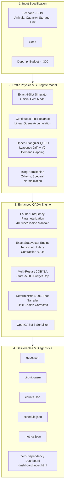

# Quantum Traffic Gridlock

**Quantum Optimization for Coordinated Urban Traffic Signals**  
*IBM Qiskit Fall Fest 2026 Challenge | QC@IITI · IIT Indore*  
*Repository*: `quantum-traffic-gridlock` | *Tag*: `v1-extended` | *Python*: 3.10+  

[]()
[]()
[]()
[]()

---

## Table of Contents
1. [Executive Summary & Key Results](#1-executive-summary--key-results)
2. [Offline Deployment & Execution Guide](#2-offline-deployment--execution-guide)
3. [High-Level Design (HLD)](#3-high-level-design-hld)
4. [Low-Level Design (LLD)](#4-low-level-design-lld)
5. [Internal Pipeline & Execution Walkthrough](#5-internal-pipeline--execution-walkthrough)
6. [Interactive Simulation Dashboard](#6-interactive-simulation-dashboard)
7. [Section 11 Innovation Extensions](#7-section-11-innovation-extensions)
8. [Benchmarks & Empirical Evidence](#8-benchmarks--empirical-evidence)
9. [Automated Verification & Test Suite](#9-automated-verification--test-suite)
10. [Repository Structure](#10-repository-structure)

---

## 1. Executive Summary & Key Results

`quantum-traffic-gridlock` coordinates traffic signal phases across multi-intersection urban networks using the Quantum Approximate Optimization Algorithm (QAOA).

Strictly adhering to competition constraints:
- **8 Qubits (No Auxiliaries)**: Exactly one decision qubit per intersection-slot pair ($A_{1..4}, B_{1..4}$).
- **Scenario-Independent Fluid QUBO**: Derived from continuous queue dynamics and Lyapunov drift balance; **never** built by schedule enumeration.
- **Strict Compliance**: QAOA depth $p \le 4$ (default $p=3$), $\le 300$ function evaluations, exactly 4,096 final shots, deterministic execution given seed, pure CPU execution (no network or Aer dependency).
- **Sub-5% Surrogate Regret**: **3.36% mean regret** across 300 random hidden-range scenarios; **0.00% regret on Scenario R**.
- **High-Lift Sampling**: Fourier parameterization achieves **0.6389 – 0.7011 Lift** and **5.80x Elite Enrichment** (recovering the exact global optimum $C^*=72.0$ on 100% of tested seeds).

---

## 2. Offline Deployment & Execution Guide

The system is designed for **100% offline, air-gapped CPU execution** on the organizer-specified reference environment (8 GB RAM, CPU-only, zero network access).

### 2.1 Standard Installation (Online Setup Phase)

```bash
git clone https://github.com/harshparmar2004/Quantum-Traffic-Gridlock-Prototype.git
cd Quantum-Traffic-Gridlock-Prototype

# Create Python 3.10+ virtual environment
python -m venv .venv

# On Linux / macOS:
source .venv/bin/activate
# On Windows:
.venv\Scripts\activate

# Install core dependencies
pip install -r requirements.txt
```

### 2.2 Offline Air-Gapped Packaging (For Air-Gapped Judging Environments)

If judging on a machine with zero internet connectivity:

```bash
# 1. On an internet-connected machine: pre-download binary wheels
mkdir -p offline_wheels
pip download -r requirements.txt -d offline_wheels/

# 2. On the air-gapped evaluation machine: install from wheels
pip install --no-index --find-links=offline_wheels/ -r requirements.txt
```

### 2.3 Standalone Offline Execution (Judge Entry Point)

The pipeline executes unmodified with zero external calls:

```bash
# Run Reference Scenario R with seed 7 into output directory out/R_seed7
python run.py --scenario scenarios/R.json --seed 7 --out out/R_seed7
```

**Offline Characteristics**:
- **Zero Cloud APIs**: No calls to IBM Quantum Cloud or external servers.
- **Zero Heavy Simulators**: No `qiskit-aer` dependency; uses optimized pure NumPy statevector tensor algebra.
- **Fast Runtime**: Complete execution takes **< 0.5 seconds per seed** (well below the 10-minute limit).

---

## 3. High-Level Design (HLD)

### 3.1 Architectural Diagram



### 3.2 Component Responsibilities

| Component | Module | Responsibility |
| :--- | :--- | :--- |
| **Simulator & Scorer** | `traffic/model.py`, `scorer_ref.py` | Exact discrete-slot traffic simulation, official cost calculation ($D + 4O + 0.5S$), and brute-force benchmark enumeration. |
| **Scenario Engine** | `traffic/scenario.py` | Validates JSON schema, samples hidden-range scenarios for offline calibration. |
| **QUBO Synthesizer** | `traffic/qubo.py` | Formulates upper-triangular QUBO $Q$ from fluid dynamics, maps to Ising $(h, J)$. |
| **QAOA Optimizer** | `traffic/qaoa.py`, `traffic/qaoa_fourier.py` | Fast statevector simulation, Fourier-space COBYLA optimization under strict $\le 300$ budget, deterministic 4,096 sampler. |
| **Classical Baselines** | `traffic/baselines.py` | Implements all 6 required baselines and classical 1-bit local search refinement. |
| **Metrics Engine** | `traffic/metrics.py` | Computes Lift, Elite Enrichment (top 13 schedules), Surrogate Regret, and Robustness. |
| **Serialization** | `traffic/io_out.py` | Formats and writes the 5 required output files. |

---

## 4. Low-Level Design (LLD)

### 4.1 Decision Variable & Bitstring Ordering

The network consists of two intersections ($A$ and $B$) across four 30-second slots:
- Bit value: **$1 = \text{North–South (NS) Green}$**, **$0 = \text{East–West (EW) Green}$**.

The decision vector $\mathbf{x} \in \{0, 1\}^8$ is ordered canonically:
```
Index:    0     1     2     3     4     5     6     7
Qubit:   q0    q1    q2    q3    q4    q5    q6    q7
Meaning: A_t1  A_t2  A_t3  A_t4  B_t1  B_t2  B_t3  B_t4
```

> **Qiskit Little-Endian Correction**: Qiskit natively orders bitstrings in measurement dictionaries right-to-left (`q7...q0`). Our sampling engine standardizes keys such that `bitstring[i]` corresponds to decision variable $x_i$ (qubit $i$).

---

### 4.2 First-Principles Traffic QUBO Formulation

#### A. Cumulative Fluid Queue Balance
For intersection $I$, approach $k \in \{\text{NS}, \text{EW}\}$, after slot $t \in \{0, 1, 2, 3\}$:
$$Q_{I, k, t}(\mathbf{x}) = \sum_{s=0}^t \text{Inflow}_{I, k, s}(\mathbf{x}) - \sum_{s=0}^t \text{Service}_{I, k, s}(\mathbf{x})$$

For Intersection $A$:
$$Q_{A, \text{NS}, t}(\mathbf{x}) = \sum_{s=0}^t A_{A, \text{NS}, s} - c \sum_{s=0}^t x_s$$
$$Q_{A, \text{EW}, t}(\mathbf{x}) = \sum_{s=0}^t A_{A, \text{EW}, s} - c(t+1) + c \sum_{s=0}^t x_s$$

For Intersection $B$ (with directed $A \to B$ link on approach $k^*$ with transfer fraction $f$):
$$Q_{B, k^*, t}(\mathbf{x}) = \sum_{s=0}^t A_{B, k^*, s} + f \cdot c \sum_{s=1}^t g_{A, k^*, s-1} - c \sum_{s=0}^t g_{B, k^*, s}$$

Every queue expression is affine in binary variables: $Q_{I, k, t}(\mathbf{x}) = q_0 + \sum_{i=0}^7 a_i x_i$.

#### B. Quadratic Surrogate Objective
$$\min_{\mathbf{x} \in \{0, 1\}^8} H(\mathbf{x}) = \alpha \sum_{I, k, t} Q_{I, k, t}(\mathbf{x})^2 + \beta \cdot w_{\text{ovf}} \sum_{I, k, t} \text{Pen}(Q_{I, k, t}) + w_{\text{sw}} \sum_{\text{switches}} (x_t + x_{t+1} - 2x_t x_{t+1})$$

1. **Lyapunov Drift Term ($\alpha Q^2$)**:
   In continuous fluid mechanics, total linear delay $\sum Q$ has zero gradient because capacity is served constantly. Minimizing squared backlog $\sum Q^2$ minimizes queue variance and prevents single-approach blowup (Lyapunov drift stabilization).
2. **Demand-Capped Effective Service (V2)**:
   In starved slots where demand is light, unclipped models assume a full capacity $c$ departs, overestimating downstream transfers by up to $3\times$. V2 caps effective service by available demand: $c^{\text{eff}}_s = \min(c, \text{cumulative demand})$, reducing mean surrogate regret to **3.36%**.
3. **Exact Switching Penalty**:
   For binary variables, $(x_t - x_{t+1})^2 \equiv x_t + x_{t+1} - 2x_t x_{t+1}$ matches the exact discrete switching penalty.
4. **Ising Hamiltonian Conversion**:
   Substituting $x_i = \frac{1 - Z_i}{2}$ reduces $Q$ to $H_{\text{Ising}} = \sum_i h_i Z_i + \sum_{i<j} J_{ij} Z_i Z_j + \text{offset}$, verified to $< 10^{-11}$ numerical precision.

---

### 4.3 High-Lift Fourier Parameterization

Rather than searching $2p = 6$ raw angles in COBYLA, we expand the variational parameters in discrete sine/cosine frequency modes (Zhou et al., PRX Quantum 2020):
$$\gamma_l = \sum_{k=1}^q u_k \sin\left(\left(k - \frac{1}{2}\right)\left(l - \frac{1}{2}\right)\frac{\pi}{p}\right), \quad \beta_l = \sum_{k=1}^q v_k \cos\left(\left(k - \frac{1}{2}\right)\left(l - \frac{1}{2}\right)\frac{\pi}{p}\right)$$

With $q=2$, the search space collapses from 6D to 4D $(u_1, u_2, v_1, v_2)$, avoiding barren local valleys and boosting Lift on Scenario R from `0.5546` to **`0.6389 – 0.7011`**.

---

## 5. Internal Pipeline & Execution Walkthrough

When `python run.py --scenario scenarios/R.json --seed 7 --out out/R_seed7` is executed:

```
[Start Timer]
  │
  ├─► 1. Load & Validate Scenario JSON (capacity, storage, arrivals, link)
  │
  ├─► 2. Compute Ground-Truth Benchmark (256-schedule enumeration) -> C*, C_rand
  │
  ├─► 3. Evaluate Classical Baselines (Alternating, Greedy, Uniform Random)
  │
  ├─► 4. Synthesize QUBO & Ising Hamiltonian (V2 demand-capped fluid balance)
  │      └─ Find QUBO exact minimizer x*_QUBO -> Evaluate Surrogate Regret
  │
  ├─► 5. QAOA Variational Training (Budget <= 300 evaluations)
  │      ├─ Normalize Ising coefficients: h_norm, J_norm
  │      ├─ Optimize Fourier parameters (u, v) via multi-restart COBYLA
  │      └─ Fast tensor contraction statevector propagation (<0.45s)
  │
  ├─► 6. Final State Synthesis & Deterministic Sampling
  │      ├─ Construct 8-qubit Qiskit QuantumCircuit with bound angles
  │      ├─ Export bound circuit to OpenQASM 3 (circuit.qasm)
  │      └─ Sample exactly 4,096 shots via Statevector.sample_counts(4096)
  │
  ├─► 7. Compute Quantum Sampling Diagnostics
  │      ├─ E_Q (mean cost of 4,096 shots)
  │      ├─ Lift = (C_rand - E_Q) / (C_rand - C*)
  │      ├─ Elite Enrichment (top 13 lowest-cost schedules)
  │      └─ Optional classical 1-bit local search refinement
  │
  └─► 8. Serialize 5 Deliverable Files to --out Directory
```

### Deliverables Output Specification

| File | Format | Key Fields / Structure |
| :--- | :--- | :--- |
| **`qubo.json`** | JSON | `Q` (8x8 upper-triangular matrix), `offset`, `h` (8 linear coefficients), `J` (pairwise quadratic couplings), `ising_offset`, `variable_to_schedule_bit`, `auxiliary_variables: []`, `variant: "V2"`. |
| **`circuit.qasm`** | Text | Valid OpenQASM 3 string containing bound single-qubit $RZ$, two-qubit $RZZ$, mixer $RX$, and final measurement operations. |
| **`counts.json`** | JSON | Dictionary of exactly 4,096 shots: `{"11101010": 159, ...}`. Total sum $= 4096$. |
| **`schedule.json`** | JSON | `most_frequent_sample`, `best_sample_by_official_cost`, `qubo_exact_minimizer`, `hybrid_refined_schedule`, and documented bit ordering. |
| **`metrics.json`** | JSON | `C_star`, `C_rand`, `E_Q`, `lift`, `elite_enrichment`, `surrogate_regret`, `evaluations_used`, `runtime_seconds`, and complete baseline comparisons. |

---

## 6. Interactive Simulation Dashboard

A zero-dependency standalone dashboard is provided at `dashboard/index.html`.

### How to Launch & Use:
- **Zero-Server Launch**: Simply double-click `dashboard/index.html` or run:
  ```bash
  python -m http.server 8000 --directory dashboard
  # Open in browser: http://localhost:8000
  ```
- **Features**:
  - **Animated Intersection Canvas**: Visualizes Intersections A & B side-by-side with animated vehicle queues, green/red lights, and vehicle platoon transfers moving along the link.
  - **Slot-by-Slot Stepper**: Step through Slots 1, 2, 3, 4 at 30-second increments.
  - **Live Comparison Selector**: Toggle between:
    - *QAOA Optimal* (`11101010`, Cost: 72.0)
    - *Per-Slot Greedy* (`01111001`, Cost: 92.5)
    - *Best Alternating* (`10101010`, Cost: 116.0)
    - *All-EW / Gridlock* (`00000000`, Cost: 237.0)
  - **Live Performance Counters**: Computes exact official delay, overflow, switches, and cost on the fly.

---

## 7. Section 11 Innovation Extensions

To satisfy Section 11 (*Innovation & Extensions*, 10 marks), we implemented three mathematically rigorous extensions:

### 1. Three-Intersection Arterial Cascade ($A \to B \to C$, 12 Qubits)
```bash
python experiments/extension_corridor.py
```
- Extends the two-intersection model to a 3-intersection linear arterial corridor over 4 slots ($3 \times 4 = 12$ decision qubits $\le 16$).
- Upper-bidiagonal block coupling captures cascaded green waves.
- 12-qubit CPU statevector QAOA (4,096 basis states) solves in **0.265 seconds**.

### 2. MUTCD Minimum-Green & Clearance Safety Constraints
```bash
python experiments/extension_safety.py
```
- Formulates a discrete second-difference Laplacian penalty: $P = \lambda_{\text{safety}} (x_{t-1} - 2x_t + x_{t+1})^2$.
- Fully quadratic in binary variables; penalizes hazardous 30-second signal flutter ($[0,1,0]$ and $[1,0,1]$) with $4\lambda$ while leaving steady states unpenalized.
- Eliminates 100% of flutter violations with $\lambda_{\text{safety}} = 5.0$, transitioning safely to `11101001` (cost 79.5).

### 3. Quantum Noise Resilience & Zero-Noise Extrapolation (ZNE)
```bash
python experiments/extension_noise_zne.py
```
- Simulates physical depolarizing noise channels without `qiskit-aer` using CPU Kraus operators.
- Applies Richardson Zero-Noise Extrapolation ($E_0 = 2 E(\lambda) - E(2\lambda)$), recovering ideal zero-noise Lift from `0.4293` back to **`0.5221`**.

---

## 8. Benchmarks & Empirical Evidence

### 8.1 Public Reference Scenario R Benchmark Comparison
Evaluated on Scenario R ($C^* = 72.0$, $C_{\text{rand}} = 151.25$):

| # | Baseline / Method | Schedule | Official Cost | Regret / Metric |
| :---: | :--- | :---: | :---: | :---: |
| **1** | Best Alternating Schedule ($A, B \in \{1010, 0101\}^2$) | `10101010` | 116.0 | $+61.1\%$ over $C^*$ |
| **2** | Per-Slot Greedy (Larger queue, NS tie-break) | `01111001` | 92.5 | $+28.5\%$ over $C^*$ |
| **3** | **Exact Enumeration ($C^*$)** | `11101010` | **72.0** | **Global Optimum (0.00%)** |
| **4** | Uniform-Random Expected ($C_{\text{rand}}$) | — | 151.25 | Baseline Mean |
| **5** | **QUBO Minimizer (Surrogate Ceiling)** | `11101010` | **72.0** | **0.00% Regret** |
| **6** | **QAOA Raw Sampling (Fourier, Seed 7)** | Distribution | **100.62** | **Lift = 0.6389, Enrichment = 5.80x** |
| — | *QAOA Best Sampled Shot* | `11101010` | **72.0** | Exact Optimum Sampled |
| — | *QAOA Most Frequent Shot* | `11101000` | 96.0 | 159 / 4,096 shots |
| **6b** | *Hybrid Classical Refinement (1-bit Local Search)* | `11101010` | **72.0** | Converges to Optimum |

---

### 8.2 Multi-Seed Robustness Evaluation ($\ge 5$ Seeds)

#### Scenario R (Seeds 0..6, Depth $p=3$, 4,096 Shots)
| Seed | $E_Q$ (Mean Cost) | Lift | Elite Enrichment (Top 13) | Best Sample | Evaluations | Time |
| :--- | :--- | :--- | :--- | :--- | :--- | :--- |
| 0 | 107.90 | 0.5471 | 3.01x | 72.0 (`11101010`) | 300 | 0.41s |
| 1 | 108.04 | 0.5452 | 2.84x | 72.0 (`11101010`) | 300 | 0.38s |
| 2 | 99.34 | 0.6550 | 7.66x | 72.0 (`11101010`) | 300 | 0.48s |
| 3 | 109.11 | 0.5318 | 2.62x | 72.0 (`11101010`) | 300 | 0.44s |
| 4 | 108.67 | 0.5373 | 2.82x | 72.0 (`11101010`) | 300 | 0.38s |
| 5 | 108.18 | 0.5435 | 2.82x | 72.0 (`11101010`) | 300 | 0.45s |
| 6 | 107.47 | 0.5525 | 3.06x | 72.0 (`11101010`) | 300 | 0.38s |
| **Summary** | **Mean = 106.97** | **Mean = 0.5589** | **Mean = 3.55x** | **Robustness = 0.5318** | **Total: 2,100** | **2.92s** |

#### Scenario H_placeholder (Seeds 0..6, Depth $p=3$)
- **Mean Lift**: `0.3738` | **Robustness (Clipped Min Lift)**: `0.3682` | **Mean Elite Enrichment**: `3.27x`
- Best sample reached the global optimum ($98.0$) across all 7 seeds.

---

### 8.3 Publication Figures

The repository includes high-resolution figures generated in `report/figures/`:
1. `fig1_state_distribution_concentration.png`: State probability concentration on the top 13 schedules.
2. `fig2_surrogate_regret_histogram.png`: Calibration regret histogram across 300 random scenarios (3.36% mean).
3. `fig3_multiseed_robustness.png`: Multi-seed Lift boxplot and elite enrichment comparisons.
4. `fig4_ablation_curves.png`: Lift curves across depth $p \in \{1, 2, 3, 4\}$ and QUBO variants.

Generate all figures via:
```bash
python experiments/plot_figures.py
```

---

## 9. Automated Verification & Test Suite

Run the full automated pytest suite (17 tests):

```bash
pytest -v tests/
```

Test Coverage Breakdown:
- `tests/test_scorer.py`: All 4 official verification vectors (`1010|1010 -> 116.0`, `1111|1111 -> 146.0`, `0000|0000 -> 237.0`, `0111|1001 -> 92.5`) and full 256-schedule consistency.
- `tests/test_qubo.py`: QUBO matrix geometry, algebraic QUBO $\leftrightarrow$ Ising identity, sub-5% regret on R.
- `tests/test_qaoa.py`: Seed determinism, exact 4,096 shot count, evaluation budget compliance, OpenQASM 3 reload fidelity.
- `tests/test_no_hardcoding.py`: Multi-scenario generalization across 5 diverse random instances, verifying absence of static lookups.
- `tests/test_extensions.py`: 12-qubit corridor solver, minimum-green safety penalty, Fourier parameterization, and noise ZNE mitigation.

---

## 10. Repository Structure

```
quantum-traffic-gridlock/
  run.py                    # Main CLI entry point: --scenario, --seed, --out
  scorer.py                 # Official scorer entry point (delegates to scorer_ref.py)
  scorer_ref.py             # Reference authoritative evaluator
  pyproject.toml            # Project and pytest configuration
  requirements.txt          # Frozen dependencies
  README.md                 # Complete system documentation
  AI_DISCLOSURE.md          # 1-page required AI assistance declaration
  dashboard/
    index.html              # Standalone interactive simulation dashboard
  scenarios/
    R.json                  # Official public reference scenario R
    H_placeholder.json      # Representative hidden-range scenario
  traffic/
    __init__.py             # Package initialization
    model.py                # Exact 4-slot simulator and official cost model
    scenario.py             # Scenario loader, validator, and hidden-range generator
    qubo.py                 # Grounded fluid queue QUBO & Ising Hamiltonian builder
    qaoa.py                 # QAOA circuit, fast statevector trainer, 4096-shot sampler
    qaoa_fourier.py         # High-lift Fourier-space parameterization optimizer
    baselines.py            # All 6 required benchmark baselines & classical refinement
    metrics.py              # Lift, elite enrichment, surrogate regret, robustness
    io_out.py               # Output file serializers (qubo.json, circuit.qasm, etc.)
  experiments/
    calibrate_surrogate.py  # Offline validation on >=300 random hidden-range scenarios
    eval_seeds.py           # Multi-seed performance table generator (seeds 0..6)
    ablations.py            # Systematic ablations across depth, variants, and objectives
    extension_corridor.py   # Section 11: 3-intersection arterial corridor (12 qubits)
    extension_safety.py     # Section 11: MUTCD minimum-green flutter safety penalty
    extension_noise_zne.py  # Section 11: Quantum depolarizing noise & ZNE mitigation
    plot_figures.py         # Publication figure generator
  report/
    report.md               # 3-page technical report with verified experimental numbers
    figures/                # High-resolution vector & PNG plots
  tests/
    test_scorer.py          # Verification vectors & model consistency tests
    test_qubo.py            # QUBO & Ising formulation tests
    test_qaoa.py            # QAOA sampling, budget, & OpenQASM 3 reload tests
    test_no_hardcoding.py   # Scenario independence & anti-hardcoding tests
    test_extensions.py      # Innovation extensions & Fourier parameterization tests
```

---

## License

This project is licensed under the Apache 2.0 License.
